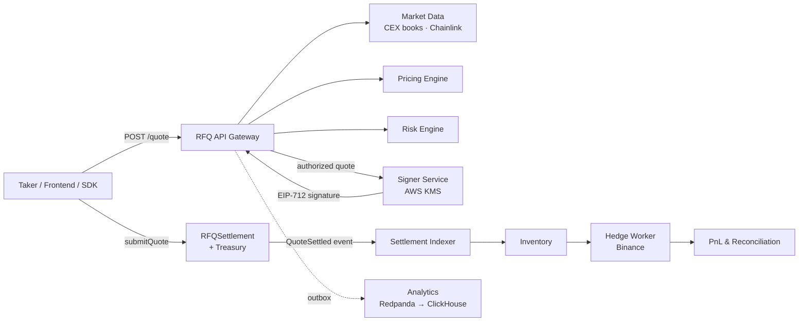

<div align="center">

# Production-Grade Web3 RFQ Market Maker

**A reference implementation of an end-to-end RFQ / Prop AMM market-making system — from off-chain quoting to on-chain settlement, hedging and PnL.**

[](https://github.com/alvis-ai/production-grade-web3-rfq-market-maker/actions/workflows/backend-ci.yml)
[](https://github.com/alvis-ai/production-grade-web3-rfq-market-maker/actions/workflows/contract-ci.yml)
[](https://github.com/alvis-ai/production-grade-web3-rfq-market-maker/actions/workflows/frontend-e2e.yml)
[](LICENSE)


English | [简体中文](README.zh-CN.md)

</div>

---

## Table of Contents

- [Overview](#overview)
- [Features](#features)
- [Architecture](#architecture)
- [Repository Layout](#repository-layout)
- [Tech Stack](#tech-stack)
- [Getting Started](#getting-started)
- [Testing and Quality Gates](#testing-and-quality-gates)
- [API at a Glance](#api-at-a-glance)
- [Smart Contracts](#smart-contracts)
- [TypeScript SDK](#typescript-sdk)
- [Deployment](#deployment)
- [Documentation](#documentation)
- [Design Principles](#design-principles)
- [Project Status](#project-status)
- [Contributing](#contributing)
- [Security](#security)
- [License](#license)

## Overview

In an RFQ (request-for-quote) market, a professional market maker prices each trade off-chain, signs a short-lived firm quote, and lets the taker settle it on-chain. This keeps prices tight and gas costs low, and it avoids the passive inventory losses of a pure AMM. The hard part is keeping the quote and its execution consistent across many moving parts: market data, pricing, inventory risk, key custody, chain finality and hedging.

This repository implements that whole lifecycle as a production-shaped reference system. It includes:

- a TypeScript backend split into an API gateway and isolated workers;
- Solidity settlement and treasury contracts;
- a React trading console and a TypeScript SDK;
- Kubernetes, Helm and observability configuration;
- 33 architecture decision records and a seven-volume engineering design book.

## Features

- **End-to-end RFQ lifecycle**: quote → risk check → EIP-712 signature → on-chain settlement → inventory update → hedge → PnL attribution.
- **Market data**: Binance and Coinbase order-book connectors with freshness, quorum and deviation checks, plus Chainlink reference prices and decimals-aware USD normalization.
- **Pricing engine**: mid price, spread, size impact, volatility premium, inventory skew and a hedge-failure penalty.
- **Risk engine**: chain-scoped token limits, projected inventory, portfolio VaR, delta and gamma-like guardrails, and dynamic toxic-flow scores derived from reorg-aware markouts.
- **Signer isolation**: only quotes that pass risk checks are signed, inside a separate service. AWS KMS signs in production, and signers rotate with a bounded overlap window.
- **Settlement contract**: EIP-712 verification, per-user nonces, deadlines, a token whitelist, role-based access, pause, reentrancy protection, and exact balance-delta checks that reject fee-on-transfer drift.
- **Post-trade pipeline**: an independent settlement indexer with reorg recovery, reconciliation workers, Binance hedge execution with fee evidence, and net PnL.
- **Analytics**: a PostgreSQL transactional outbox → Redpanda → ClickHouse, kept outside the trading request path.
- **Low-latency quote path**: hot state in Redis, atomic Lua admission and asynchronous PostgreSQL projection.
- **Operability**: Prometheus metrics, Grafana dashboards, alert rules with runbooks, structured logging and trace correlation.
- **Hardened delivery**: restricted container runtimes, Cilium FQDN egress policies, signed release images with an SBOM, and opt-in live-integration canaries.

## Architecture



Core flow:

```text
/quote → market data → pricing → risk → EIP-712 signed quote
       → /submit → contract verification → settlement
       → inventory update → hedge → metrics / PnL
```

More diagrams (quote, submit and hedge sequences, plus the risk state machine) are in [`docs/diagrams`](docs/diagrams).

| Component | Responsibility |
| --- | --- |
| RFQ API | Accepts quote requests and orchestrates market data, pricing, risk and signing. |
| Market Data Service | Maintains external price sources, on-chain liquidity and normalized price snapshots. |
| Routing Engine | Chooses between internal inventory, external venues and future aggregation routes. |
| Pricing Engine | Builds quotes from mid price, spread, size impact, volatility premium and inventory skew. |
| Risk Engine | Enforces trade size, projected inventory, spread, slippage, toxic flow, VaR and delta/gamma limits. |
| Toxic-Flow Analyzer | Computes reorg-aware markouts and publishes audited per-user risk scores with CAS. |
| EIP-712 Signer | Signs only short-lived quotes that passed risk checks. |
| RFQSettlement Contract | Verifies signature, nonce, deadline, whitelist and settlement bounds on-chain. |
| Inventory Service | Records post-trade inventory and feeds pricing and hedging. |
| Hedge Engine | Hedges inventory exposure on external venues or on-chain routes. |
| Analytics Pipeline | Stores replayable business events; analytics failures never block trading. |
| Observability | Exposes quote, submit, settlement, PnL and risk metrics. |
| Frontend / SDK | Trading console, quote status and a typed TypeScript client. |

## Repository Layout

```text
backend/     TypeScript / Fastify RFQ gateway, signer and background workers
contracts/   Solidity settlement contracts and Foundry tests
frontend/    React + Vite trading console
sdk/         TypeScript SDK and EIP-712 helpers
docs/        ADRs, OpenAPI spec, diagrams, database schema, security and operations docs
book/        Long-form engineering design volumes (Chinese)
infra/       Docker, Kubernetes, Helm, Prometheus and Grafana configuration
benchmark/   Quote and submit latency benchmarks
scripts/     Consistency checks, integration canaries and end-to-end tests
examples/    Example API payloads
```

## Tech Stack

| Layer | Technologies |
| --- | --- |
| Backend | Node.js 22, TypeScript, Fastify, PostgreSQL, Redis, Redpanda, ClickHouse |
| Smart contracts | Solidity 0.8.24, Foundry, OpenZeppelin Contracts 5.6.1 |
| Frontend | React, Vite, TypeScript, wagmi, viem, RainbowKit, TanStack Query |
| Infrastructure | Docker Compose, Kubernetes, Helm, GitHub Actions, Prometheus, Grafana |

## Getting Started

### Prerequisites

- Node.js 22 and pnpm 9 (`corepack enable`)
- [Foundry](https://book.getfoundry.sh/getting-started/installation) (`forge`, `anvil`)
- Docker with Compose v2 (for the full local stack)

### Install

```sh
git clone --recursive https://github.com/alvis-ai/production-grade-web3-rfq-market-maker.git
cd production-grade-web3-rfq-market-maker
corepack enable
pnpm install --frozen-lockfile
cp .env.example .env
```

If you cloned without `--recursive`, run `git submodule update --init --recursive` to fetch OpenZeppelin.

> [!WARNING]
> `.env.example` contains the public Anvil development signer key. Use it only on local chains.

### Run the local stack

```sh
docker compose up --build
```

| Service | URL |
| --- | --- |
| Backend API | http://localhost:3000 |
| Frontend console | http://localhost:5173 |
| Prometheus | http://localhost:9090 |
| Grafana | http://localhost:3001 |

Optional workers start through Compose profiles: `hedge`, `analytics`, `reconciliation`, `indexer` and `toxic-flow`. For example:

```sh
docker compose --profile analytics up --build analytics-worker
```

See [Local Docker Stack](docs/operations.md#local-docker-stack) for every profile and port.

### Settle a quote end to end on Anvil

This deploys the contracts to a local Anvil chain, requests and signs a quote, settles it on-chain, and checks the resulting hedge and PnL records:

```sh
make settlement-e2e
```

## Testing and Quality Gates

```sh
make verify          # full local quality gate (checks, unit tests, benchmarks, e2e)
make backend-test    # backend unit tests
make sdk-test        # SDK unit tests
make frontend-test   # frontend unit tests
make contract-test   # Foundry unit, fuzz and invariant tests
make frontend-e2e    # Playwright browser tests
```

`make verify` also runs about 40 consistency checks. They keep the code, configuration, docs, dashboards, alerts and deployment manifests in agreement. Run `make help` for the full list of targets.

Credentialed checks against real services (CEX streams, Chainlink, the Binance Spot Testnet, AWS KMS, a target chain and a staging API) are opt-in. They run from the [`Live Integrations`](.github/workflows/live-integrations.yml) workflow. See [Operations](docs/operations.md) for setup.

## API at a Glance

The full contract is in [`docs/api/openapi.yaml`](docs/api/openapi.yaml), and error codes are in [`docs/api/errors.md`](docs/api/errors.md).

```http
POST /quote                     # request a signed firm quote
POST /submit                    # report a settlement transaction
GET  /quote/:id                 # quote status
GET  /settlements/:id
GET  /hedges/:id
GET  /pnl?limit=50&cursor=...
GET  /health | /ready | /metrics
```

The `/admin/quote-control` and `/admin/toxic-flow` endpoints let operators control quoting and toxic-flow scores. Non-local deployments require scoped API keys, and every response carries an `x-trace-id` header.

<details>
<summary>Example <code>POST /quote</code></summary>

Request:

```json
{
  "chainId": 1,
  "user": "0xUser",
  "tokenIn": "0xUSDC",
  "tokenOut": "0xWETH",
  "amountIn": "1000000000",
  "slippageBps": 50
}
```

Response:

```json
{
  "quoteId": "q_abc123",
  "snapshotId": "s_98765",
  "amountOut": "332100000000000000",
  "minAmountOut": "330400000000000000",
  "deadline": 1730000000,
  "nonce": "12345",
  "signature": "0x..."
}
```

</details>

## Smart Contracts

`RFQSettlement` exposes a single settlement entry point:

```solidity
function submitQuote(Quote calldata quote, bytes calldata signature)
    external nonReentrant whenNotPaused returns (uint256 amountOut);
```

- Verifies the EIP-712 signature against a bounded trusted-signer set and rejects high-s signatures.
- Enforces per-user nonces, deadlines, the chain id, a token whitelist and `minAmountOut`.
- Moves `tokenIn` into a separate `Treasury` and releases `tokenOut` through a settlement-only call. The observed balance deltas must match the quote exactly.
- Uses role-based administration (signer, token, treasury and pauser roles) and cannot orphan its last admin.
- Deploys atomically through a factory that hands every role to the final admin and keeps no authority.

The contracts are covered by unit, fuzz and stateful invariant tests, and a Slither gate runs in CI. Deployment and target-chain verification are documented in [Smart Contract Surface](docs/operations.md#smart-contract-surface).

## TypeScript SDK

```ts
import { RFQClient } from "@rfq-market-maker/sdk";

const client = new RFQClient("https://rfq.example.com", { apiKey: () => currentApiKey });

const quote = await client.quote(request);
await client.submit({ quote, signature });
const status = await client.getQuote(quote.quoteId);
```

The SDK validates every response field and preserves structured API errors with trace ids. It also ships viem/wagmi helpers for allowances, `submitQuote` calls and event decoding. See [TypeScript SDK](docs/operations.md#typescript-sdk).

## Deployment

- **Kubernetes**: raw manifests are in [`infra/k8s`](infra/k8s), and a Helm chart is in [`infra/helm/rfq-market-maker`](infra/helm/rfq-market-maker).
- **Observability**: Prometheus rules are in [`infra/prometheus`](infra/prometheus), and dashboards are in [`infra/grafana`](infra/grafana).
- **Releases**: the [`release`](.github/workflows/release.yml) workflow builds and signs container images with an SBOM and provenance, then publishes the Helm chart.

Production configuration covers KMS signing, TLS for dependencies, rate limits, CEX routes, Chainlink feeds and signer rotation. It is documented in [Production Configuration](docs/operations.md#production-configuration) and [`docs/security`](docs/security).

## Documentation

| Topic | Location |
| --- | --- |
| Operations and configuration reference | [`docs/operations.md`](docs/operations.md) |
| Architecture decision records | [`docs/adr`](docs/adr) |
| API specification and errors | [`docs/api`](docs/api) |
| Database schema and ER diagram | [`docs/database`](docs/database) |
| Security: threat model, key management, audit checklist | [`docs/security`](docs/security) |
| Sequence and state diagrams | [`docs/diagrams`](docs/diagrams) |
| Interview guide (Chinese) | [`docs/interview`](docs/interview) |

Engineering design book (Chinese):

1. [System Architecture](book/Volume1-SystemArchitecture/README.md)
2. [Market Data and Pricing](book/Volume2-MarketData-And-Pricing/README.md)
3. [Risk Engine](book/Volume3-RiskEngine/README.md)
4. [Smart Contracts](book/Volume4-SmartContracts/README.md)
5. [Backend Engineering](book/Volume5-BackendEngineering/README.md)
6. [Frontend and SDK](book/Volume6-Frontend-And-SDK/README.md)
7. [Production Deployment](book/Volume7-ProductionDeployment/README.md)

## Design Principles

1. Quote and execution consistency is the core invariant.
2. Risk is evaluated before a quote is signed.
3. Signed quotes are short-lived.
4. Inventory is managed off-chain but enforced through pricing and limits.
5. Smart contracts stay minimal and deterministic.
6. Risky logic stays off-chain.
7. Every state change is observable through events and metrics.
8. Every significant decision has an ADR.
9. Every critical component is testable.
10. Every diagram is reproducible with Mermaid.

## Project Status

This project is a **reference implementation**. The engineering quality gates pass, but the contracts have **not been audited by a third party**, and no public mainnet deployment is maintained. Before you deploy it with real funds:

- get an independent smart-contract audit;
- run the credentialed live-integration canaries against your own staging environment;
- confirm your latency SLOs on your own infrastructure. The local benchmark currently misses its p50 target of 10 ms (see [benchmarks](docs/operations.md#production-configuration)).

## Contributing

Issues and pull requests are welcome. Before you open a pull request:

1. Run `make verify` and make sure it passes.
2. Keep code, docs and configuration consistent; the consistency checks will tell you what is out of sync.
3. Add or update an [ADR](docs/adr) for any significant design decision.
4. Use [Conventional Commits](https://www.conventionalcommits.org/) for commit messages, for example `feat:`, `fix:`, `perf:` or `test:`.

## Security

Please do **not** open public issues for security vulnerabilities. Report them privately through [GitHub Security Advisories](https://github.com/alvis-ai/production-grade-web3-rfq-market-maker/security/advisories/new). The threat model and audit checklist are in [`docs/security`](docs/security).

## License

Released under the [MIT License](LICENSE).
