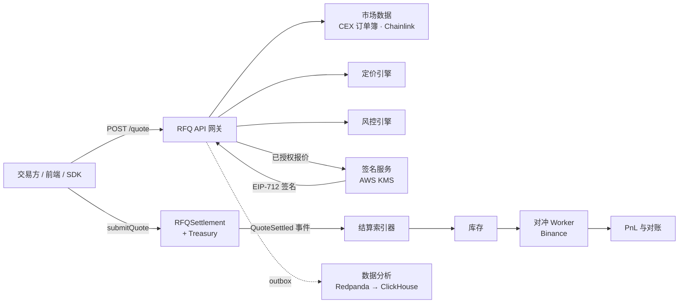

<div align="center">

# Production-Grade Web3 RFQ Market Maker

**生产级 Web3 RFQ / Prop AMM 做市系统参考实现：覆盖链下报价、链上结算、对冲和 PnL 全链路。**

[](https://github.com/alvis-ai/production-grade-web3-rfq-market-maker/actions/workflows/backend-ci.yml)
[](https://github.com/alvis-ai/production-grade-web3-rfq-market-maker/actions/workflows/contract-ci.yml)
[](https://github.com/alvis-ai/production-grade-web3-rfq-market-maker/actions/workflows/frontend-e2e.yml)
[](LICENSE)


[English](README.md) | 简体中文

</div>

---

## 目录

- [项目简介](#项目简介)
- [功能特性](#功能特性)
- [系统架构](#系统架构)
- [目录结构](#目录结构)
- [技术栈](#技术栈)
- [快速开始](#快速开始)
- [测试与质量门禁](#测试与质量门禁)
- [API 概览](#api-概览)
- [智能合约](#智能合约)
- [TypeScript SDK](#typescript-sdk)
- [部署](#部署)
- [文档](#文档)
- [设计原则](#设计原则)
- [项目状态](#项目状态)
- [参与贡献](#参与贡献)
- [安全](#安全)
- [许可证](#许可证)

## 项目简介

在 RFQ（询价）模式下，专业做市商在链下为每笔交易定价，签发一个短时有效的确定性报价，由交易方拿着报价到链上完成结算。和纯 AMM 相比，这种模式价差更窄、Gas 更低，也不会因为被动持仓而亏损。难点在于，报价和成交之间牵涉市场数据、定价、库存风险、密钥托管、链上最终性和对冲等多个环节，必须让它们保持一致。

本仓库按生产级标准实现了这条完整链路，包括：

- TypeScript 后端：一个 API 网关加若干相互隔离的 worker；
- Solidity 结算合约和金库合约；
- React 交易页面和 TypeScript SDK；
- Kubernetes、Helm 和可观测性配置；
- 33 篇架构决策记录（ADR）和七卷工程设计书。

## 功能特性

- **完整 RFQ 生命周期**：报价 → 风控 → EIP-712 签名 → 链上结算 → 库存更新 → 对冲 → PnL 归因。
- **市场数据**：Binance、Coinbase 订单簿接入，带新鲜度、多源一致（quorum）和偏离检查；另有 Chainlink 参考价，以及考虑代币精度的 USD 归一化。
- **定价引擎**：基于中间价、价差、规模冲击、波动率溢价和库存偏移定价，对冲失败时还会额外加价。
- **风控引擎**：按链和代币设置限额，检查投影库存，并执行组合 VaR、Delta 和类 Gamma 护栏；毒性流（toxic flow）分数会根据成交后的 markout 动态更新，并能正确处理链重组（reorg）。
- **签名隔离**：只有通过风控的报价才会送到独立的签名服务。生产环境用 AWS KMS 签名，轮换签名者时新旧密钥只在有限窗口内同时有效。
- **结算合约**：EIP-712 签名验证、按用户的 nonce、截止时间、代币白名单、角色权限、暂停和防重入；同时核对实际余额变化，拒绝转账时扣费的代币。
- **成交后处理**：独立的链上事件索引器（能从链重组中恢复）、对账 worker、带手续费凭证的 Binance 对冲执行，以及净 PnL 计算。
- **数据分析**：PostgreSQL 事务 outbox → Redpanda → ClickHouse，不在交易请求路径上。
- **低延迟报价**：热数据放在 Redis，用 Lua 脚本原子化完成准入，再异步写回 PostgreSQL。
- **可运维性**：Prometheus 指标、Grafana 看板、配有处置手册的告警规则、结构化日志和链路追踪 ID。
- **安全交付**：受限的容器运行环境、Cilium 按域名限制出站流量、发布镜像带签名和 SBOM，以及可选开启的真实环境集成检查。

## 系统架构



核心流程：

```text
/quote → 市场数据 → 定价 → 风控 → EIP-712 签名报价
       → /submit → 合约校验 → 结算
       → 库存更新 → 对冲 → 指标 / PnL
```

报价、提交、对冲的时序图和风控状态机见 [`docs/diagrams`](docs/diagrams)。

| 组件 | 职责 |
| --- | --- |
| RFQ API | 接收报价请求，串联市场数据、定价、风控和签名。 |
| 市场数据服务 | 维护外部价格源、链上流动性和归一化价格快照。 |
| 路由引擎 | 在内部库存、外部交易场所和未来的聚合路径之间选择报价来源。 |
| 定价引擎 | 基于中间价、价差、规模冲击、波动率溢价和库存偏移生成报价。 |
| 风控引擎 | 校验单笔金额、投影库存、价差、滑点、毒性流、VaR 和 Delta/Gamma 限额。 |
| 毒性流分析器 | 计算考虑链重组的 markout，并用 CAS 发布可审计的用户风险分数。 |
| EIP-712 签名服务 | 只为通过风控的短时报价签名。 |
| RFQSettlement 合约 | 在链上校验签名、nonce、截止时间、白名单和成交边界。 |
| 库存服务 | 记录成交后的库存变化，供定价和对冲使用。 |
| 对冲引擎 | 根据库存敞口在外部交易场所或链上路径下单对冲。 |
| 数据分析管道 | 保存可重放的业务事件；分析链路故障不会阻塞交易。 |
| 可观测性 | 暴露报价、提交、结算、PnL 和风险相关指标。 |
| 前端 / SDK | 交易页面、报价状态展示和带类型的 TypeScript 客户端。 |

## 目录结构

```text
backend/     TypeScript / Fastify RFQ 网关、签名服务和后台 worker
contracts/   Solidity 结算合约与 Foundry 测试
frontend/    React + Vite 交易页面
sdk/         TypeScript SDK 与 EIP-712 工具
docs/        ADR、OpenAPI、架构图、数据库模型、安全与运维文档
book/        长篇工程设计书（中文）
infra/       Docker、Kubernetes、Helm、Prometheus、Grafana 配置
benchmark/   报价与提交延迟基准测试
scripts/     一致性检查、集成检查和端到端测试
examples/    API 请求示例
```

## 技术栈

| 层 | 技术 |
| --- | --- |
| 后端 | Node.js 22、TypeScript、Fastify、PostgreSQL、Redis、Redpanda、ClickHouse |
| 智能合约 | Solidity 0.8.24、Foundry、OpenZeppelin Contracts 5.6.1 |
| 前端 | React、Vite、TypeScript、wagmi、viem、RainbowKit、TanStack Query |
| 基础设施 | Docker Compose、Kubernetes、Helm、GitHub Actions、Prometheus、Grafana |

## 快速开始

### 环境要求

- Node.js 22 和 pnpm 9（执行 `corepack enable` 即可）
- [Foundry](https://book.getfoundry.sh/getting-started/installation)（`forge`、`anvil`）
- Docker 与 Compose v2（运行完整本地环境时需要）

### 安装

```sh
git clone --recursive https://github.com/alvis-ai/production-grade-web3-rfq-market-maker.git
cd production-grade-web3-rfq-market-maker
corepack enable
pnpm install --frozen-lockfile
cp .env.example .env
```

如果克隆时没加 `--recursive`，请执行 `git submodule update --init --recursive` 拉取 OpenZeppelin。

> [!WARNING]
> `.env.example` 里的签名私钥是公开的 Anvil 开发密钥，只能在本地链上使用。

### 启动本地环境

```sh
docker compose up --build
```

| 服务 | 地址 |
| --- | --- |
| 后端 API | http://localhost:3000 |
| 前端页面 | http://localhost:5173 |
| Prometheus | http://localhost:9090 |
| Grafana | http://localhost:3001 |

其他 worker 通过 Compose profile 按需启动：`hedge`、`analytics`、`reconciliation`、`indexer`、`toxic-flow`。例如：

```sh
docker compose --profile analytics up --build analytics-worker
```

全部 profile 和端口见运维文档的 [Local Docker Stack](docs/operations.md#local-docker-stack) 一节。

### 在 Anvil 上跑通一笔完整结算

以下命令会把合约部署到本地 Anvil 链，请求并签发一个报价，在链上完成结算，然后检查生成的对冲和 PnL 记录：

```sh
make settlement-e2e
```

## 测试与质量门禁

```sh
make verify          # 完整本地质量门禁（一致性检查、单元测试、基准测试、端到端测试）
make backend-test    # 后端单元测试
make sdk-test        # SDK 单元测试
make frontend-test   # 前端单元测试
make contract-test   # Foundry 单元测试、fuzz 测试和不变量测试
make frontend-e2e    # Playwright 浏览器测试
```

`make verify` 还会运行约 40 项一致性检查，确保代码、配置、文档、看板、告警和部署清单彼此一致。执行 `make help` 可查看全部命令。

需要真实凭证的集成检查默认关闭，覆盖交易所行情、Chainlink、Binance 测试网、AWS KMS、目标链和 staging API。它们由 [`Live Integrations`](.github/workflows/live-integrations.yml) 工作流运行，配置方法见[运维文档](docs/operations.md)。

## API 概览

完整接口定义见 [`docs/api/openapi.yaml`](docs/api/openapi.yaml)，错误码见 [`docs/api/errors.md`](docs/api/errors.md)。

```http
POST /quote                     # 请求一个已签名的确定性报价
POST /submit                    # 上报结算交易
GET  /quote/:id                 # 查询报价状态
GET  /settlements/:id
GET  /hedges/:id
GET  /pnl?limit=50&cursor=...
GET  /health | /ready | /metrics
```

运维人员可以通过 `/admin/quote-control` 和 `/admin/toxic-flow` 控制报价开关和毒性流分数。非本地环境必须使用带权限范围的 API Key，每个响应都带有 `x-trace-id` 头。

<details>
<summary><code>POST /quote</code> 示例</summary>

请求：

```json
{
  "chainId": 1,
  "user": "0xUser",
  "tokenIn": "0xUSDC",
  "tokenOut": "0xWETH",
  "amountIn": "1000000000",
  "slippageBps": 50
}
```

响应：

```json
{
  "quoteId": "q_abc123",
  "snapshotId": "s_98765",
  "amountOut": "332100000000000000",
  "minAmountOut": "330400000000000000",
  "deadline": 1730000000,
  "nonce": "12345",
  "signature": "0x..."
}
```

</details>

## 智能合约

`RFQSettlement` 只有一个结算入口：

```solidity
function submitQuote(Quote calldata quote, bytes calldata signature)
    external nonReentrant whenNotPaused returns (uint256 amountOut);
```

- 用一组数量有上限的可信签名者校验 EIP-712 签名，并拒绝 high-s 签名。
- 校验按用户的 nonce、截止时间、链 ID、代币白名单和 `minAmountOut`。
- 把 `tokenIn` 转入独立的 `Treasury`，再通过只有结算合约能调用的接口释放 `tokenOut`；两边实际余额变化必须与报价完全一致。
- 按角色分权管理（签名者、代币、金库、暂停四类角色），并且不允许撤销最后一个管理员。
- 通过工厂合约原子化部署，所有角色都移交给最终管理员，工厂自身不保留任何权限。

合约有单元测试、fuzz 测试和有状态不变量测试覆盖，CI 中还会运行 Slither 静态分析。部署和目标链核验步骤见运维文档的 [Smart Contract Surface](docs/operations.md#smart-contract-surface) 一节。

## TypeScript SDK

```ts
import { RFQClient } from "@rfq-market-maker/sdk";

const client = new RFQClient("https://rfq.example.com", { apiKey: () => currentApiKey });

const quote = await client.quote(request);
await client.submit({ quote, signature });
const status = await client.getQuote(quote.quoteId);
```

SDK 会逐字段校验响应，保留带追踪 ID 的结构化 API 错误，还提供基于 viem/wagmi 的授权额度、`submitQuote` 调用和事件解码工具。详见运维文档的 [TypeScript SDK](docs/operations.md#typescript-sdk) 一节。

## 部署

- **Kubernetes**：原生清单在 [`infra/k8s`](infra/k8s)，Helm Chart 在 [`infra/helm/rfq-market-maker`](infra/helm/rfq-market-maker)。
- **可观测性**：Prometheus 规则在 [`infra/prometheus`](infra/prometheus)，Grafana 看板在 [`infra/grafana`](infra/grafana)。
- **发布**：[`release`](.github/workflows/release.yml) 工作流构建容器镜像并签名，附带 SBOM 和来源证明（provenance），然后发布 Helm Chart。

生产配置涉及 KMS 签名、依赖服务的 TLS、限流、CEX 路由、Chainlink 价格源和签名者轮换，见运维文档的 [Production Configuration](docs/operations.md#production-configuration) 一节和 [`docs/security`](docs/security)。

## 文档

| 主题 | 位置 |
| --- | --- |
| 运维与配置参考（英文） | [`docs/operations.md`](docs/operations.md) |
| 架构决策记录（英文） | [`docs/adr`](docs/adr) |
| API 定义与错误码 | [`docs/api`](docs/api) |
| 数据库模型与 ER 图 | [`docs/database`](docs/database) |
| 安全：威胁模型、密钥管理、审计清单 | [`docs/security`](docs/security) |
| 时序图与状态机 | [`docs/diagrams`](docs/diagrams) |
| 面试指南 | [`docs/interview`](docs/interview) |

工程设计书：

1. [系统架构](book/Volume1-SystemArchitecture/README.md)
2. [市场数据与定价](book/Volume2-MarketData-And-Pricing/README.md)
3. [风控引擎](book/Volume3-RiskEngine/README.md)
4. [智能合约](book/Volume4-SmartContracts/README.md)
5. [后端工程](book/Volume5-BackendEngineering/README.md)
6. [前端与 SDK](book/Volume6-Frontend-And-SDK/README.md)
7. [生产部署](book/Volume7-ProductionDeployment/README.md)

## 设计原则

1. 报价与成交一致是核心不变量。
2. 先过风控，再签名报价。
3. 签名报价只在很短时间内有效。
4. 库存在链下管理，通过定价和限额来约束。
5. 智能合约保持最小化、行为确定。
6. 有风险的逻辑留在链下。
7. 每一次状态变化都能通过事件和指标观测到。
8. 每个重要决策都有 ADR 记录。
9. 每个关键组件都可测试。
10. 每张架构图都能用 Mermaid 复现。

## 项目状态

本项目是一个**参考实现**。工程质量门禁全部通过，但合约**尚未经过第三方审计**，也没有维护公开的主网部署。如果要用于真实资金，请先：

- 找独立机构做一次智能合约审计；
- 在自己的 staging 环境里跑一遍需要真实凭证的集成检查；
- 在自己的基础设施上确认延迟 SLO。本地基准测试的 p50 目前还没达到 10ms 的目标（见[基准测试说明](docs/operations.md#production-configuration)）。

## 参与贡献

欢迎提交 Issue 和 Pull Request。提交 PR 前请：

1. 运行 `make verify`，确认全部通过。
2. 保持代码、文档和配置一致；一致性检查会指出哪里没有同步。
3. 重要的设计决策需要新增或更新 [ADR](docs/adr)。
4. 提交信息遵循 [Conventional Commits](https://www.conventionalcommits.org/zh-hans/) 规范，例如 `feat:`、`fix:`、`perf:`、`test:`。

## 安全

发现安全漏洞时，请**不要**提交公开 Issue，请通过 [GitHub Security Advisories](https://github.com/alvis-ai/production-grade-web3-rfq-market-maker/security/advisories/new) 私下报告。威胁模型和审计清单见 [`docs/security`](docs/security)。

## 许可证

本项目基于 [MIT License](LICENSE) 开源。
