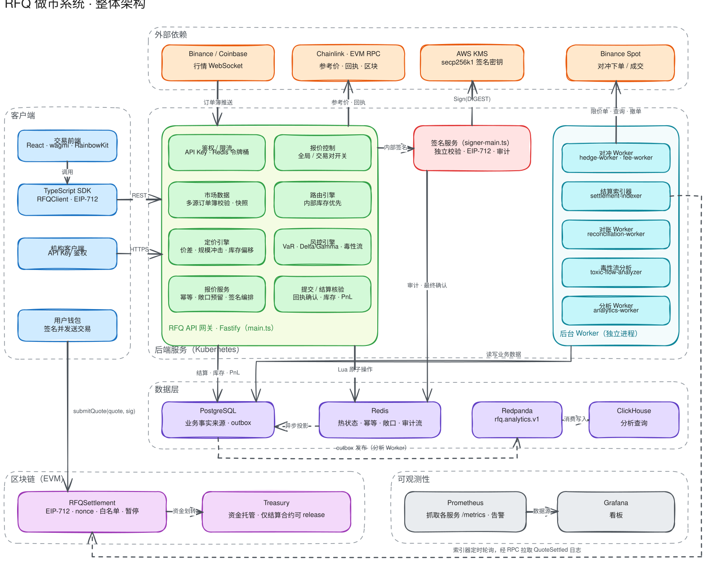
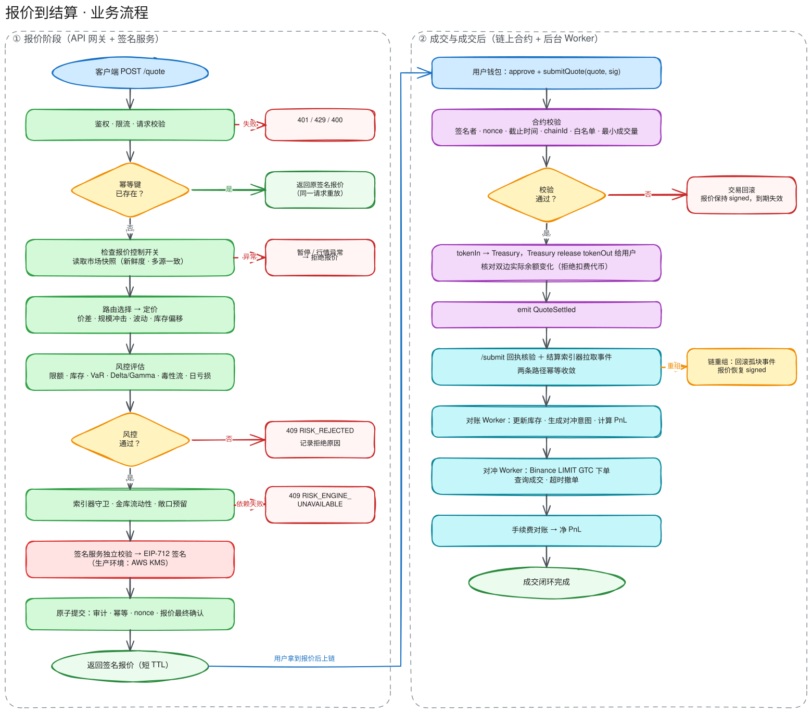
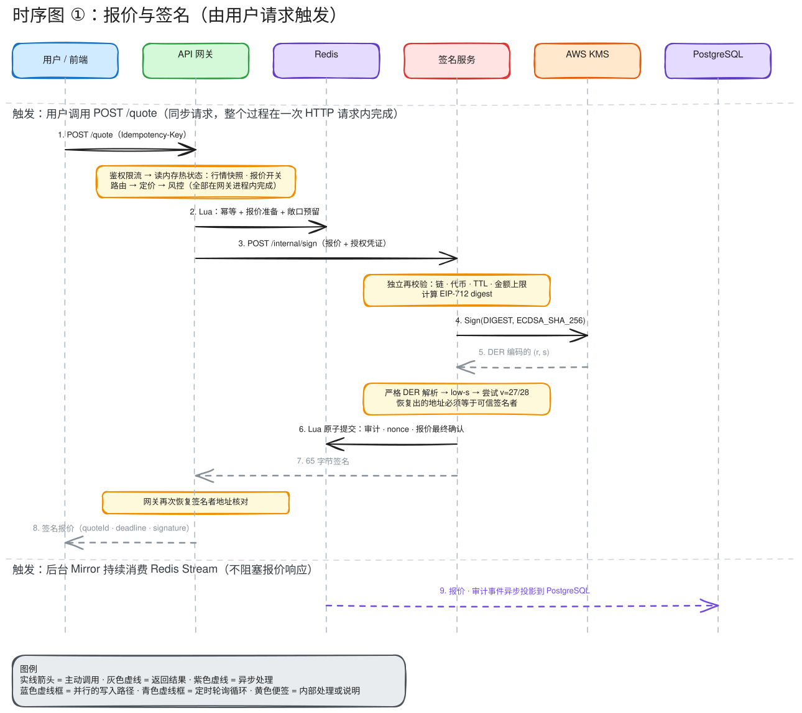
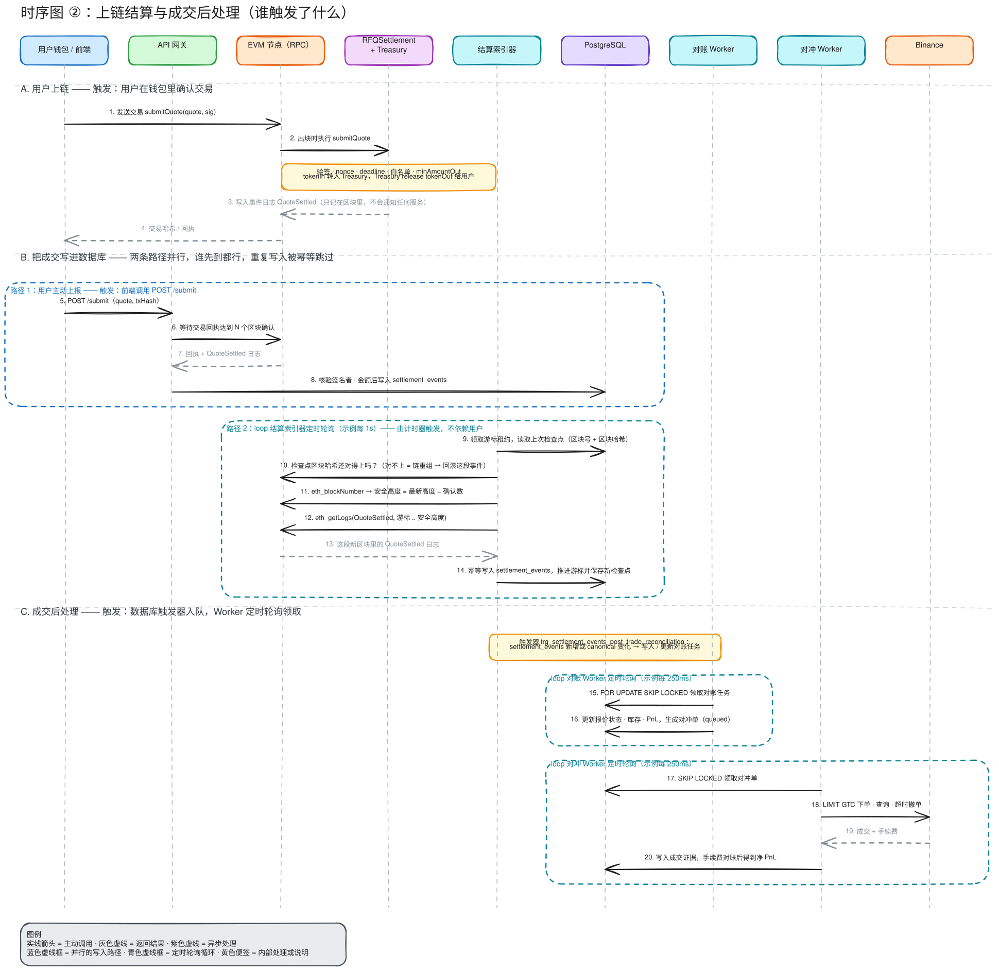
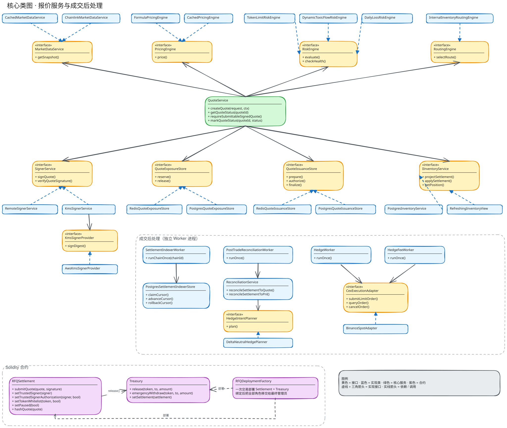

# Excalidraw 架构图

五张可编辑的手绘风格图，帮助快速理解系统。`.excalidraw` 是源文件，`.svg` 是导出的预览图。

| 图 | 内容 | 源文件 |
| --- | --- | --- |
| 整体架构图 | 客户端、API 网关模块、签名服务、后台 Worker、数据层、外部依赖、合约与可观测性 | [`architecture.excalidraw`](architecture.excalidraw) |
| 业务流程图 | 报价阶段的校验与拒绝分支，以及上链结算、索引、对账、对冲的成交后流程 | [`quote-flow.excalidraw`](quote-flow.excalidraw) |
| 时序图 ①：报价与签名 | 一次 `POST /quote` 请求内网关、Redis、签名服务、KMS 的调用顺序 | [`quote-sequence.excalidraw`](quote-sequence.excalidraw) |
| 时序图 ②：结算与成交后 | 用户上链后，`/submit` 与索引器两条写入路径如何汇合，以及触发器和各 Worker 的轮询如何驱动对账与对冲 | [`settlement-sequence.excalidraw`](settlement-sequence.excalidraw) |
| 核心类图 | `QuoteService` 依赖的接口与实现、成交后 Worker、Solidity 合约 | [`class-diagram.excalidraw`](class-diagram.excalidraw) |

## 整体架构图



## 业务流程图



## 时序图 ①：报价与签名



## 时序图 ②：上链结算与成交后处理



这张图的要点是"谁触发了什么"，因为成交后的环节都不是被直接调用的：

- **合约不会通知任何服务。** `submitQuote` 执行后只把 `QuoteSettled` 事件写进区块日志。
- **两条路径把成交写进 `settlement_events`。** 路径 1：前端调用 `POST /submit`，网关等回执达到 N 个确认后写入。路径 2：结算索引器按计时器轮询（`RFQ_SETTLEMENT_INDEXER_POLL_INTERVAL_MS`），经 RPC 用 `eth_getLogs` 拉取安全高度以内的新事件后写入。两条路径谁先到都行，重复写入会被幂等跳过；即使用户从不调用 `/submit`，索引器也会补上。
- **链重组由索引器发现。** 每轮先比对上次保存的检查点区块哈希，对不上就回滚这段事件，并把报价恢复为 `signed`。
- **后续环节由数据库触发器驱动。** `settlement_events` 新增或 `canonical` 变化时，触发器 `trg_settlement_events_post_trade_reconciliation` 写入对账任务；对账 Worker 和对冲 Worker 再分别用 `FOR UPDATE SKIP LOCKED` 定时领取各自的任务（`RFQ_RECONCILIATION_POLL_INTERVAL_MS`、`RFQ_HEDGE_POLL_INTERVAL_MS`）。

## 核心类图



## 编辑与更新

- **直接编辑**：在 [excalidraw.com](https://excalidraw.com) 用 *Open* 打开 `.excalidraw` 文件，或在 VS Code 安装 Excalidraw 扩展后直接打开。
- **按代码重新生成**：图由 [`scripts/generate-excalidraw-diagrams.mjs`](../../../scripts/generate-excalidraw-diagrams.mjs) 生成，布局和文字都写在脚本里。架构变化时优先改脚本，再运行：

  ```sh
  make diagrams
  ```

  重新生成会覆盖在 Excalidraw 里手动做的修改。
- **更新 SVG 预览**：在 Excalidraw 中打开更新后的源文件，用 *Export image → SVG* 导出并覆盖同名 `.svg`。

这些图是概览，不替代 [`docs/diagrams`](..) 下的 Mermaid 图和 [ADR](../../adr)。细节以代码和 ADR 为准。
